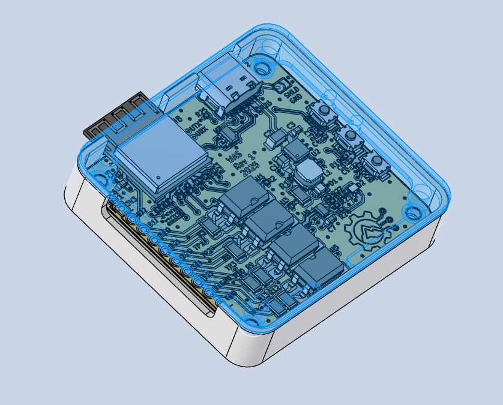
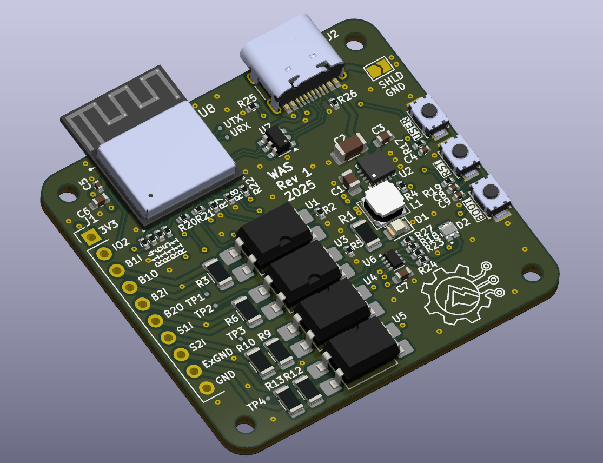

# WAS — WiFi Activated Switcher

**An ESP32-C3-based interface for controlling an existing three-speed ventilation system through Wi-Fi, MQTT and Home Assistant.**

## Overview

WAS adds network control to a conventional ventilation control panel without replacing its existing controls. It uses two outputs to emulate operation of the panel's switching interface, reads the actual ventilation setting through feedback inputs, and reports that setting to an MQTT broker.

Commands can be issued from Home Assistant or any MQTT client. Changes made using the original physical panel are also detected and published, keeping the reported state in sync with the equipment.

The project combines a custom PCB, an ESP32-C3, an RGB status indicator, a 3D-modelled enclosure and C++ firmware developed with PlatformIO.

## Features

- **Three ventilation settings:** `Min`, `Normal` and `Max`.
- **MQTT control:** receive speed requests and publish the detected current setting.
- **Physical-panel feedback:** sense the `Normal` and `Max` states; neither active is interpreted as `Min`.
- **Closed-loop switching:** operate the switching outputs, read back the actual setting and retry if needed.
- **Manual control preserved:** detect a change made at the existing panel and report it over MQTT.
- **RGB status indication:** display connection, switching and state/error information using an LP5817 LED driver.
- **Custom hardware:** KiCad PCB, component libraries, Autodesk Inventor assembly and enclosure models.

## Project images

### PCB

### PCB 3D views

| Front | Back |
| :---: | :---: |
|  |  |

### Schematic overview

Additional PCB layer views and review renders are available in [`Electronics/WAS/Review images/`](Electronics/WAS/Review%20images/).

## How it works

1. The ESP32-C3 connects to the configured Wi-Fi network and MQTT broker.
2. It subscribes to `WAS/setVentilationState` for speed requests.
3. On a request, it compares the requested setting with the setting detected from its feedback inputs.
4. If they differ, it pulses the panel-bypass outputs and checks the feedback again, retrying within a defined limit.
5. It publishes the detected setting on `WAS/currentVentilationState`. It also reports changes initiated at the physical panel and periodically republishes the state.

> **Safety:** This is a custom retrofit electronics project, not a certified universal ventilation controller. Check electrical compatibility, isolation, power supply requirements and applicable electrical safety requirements before connecting it to equipment. The firmware's MQTT connection uses the configured broker on port `1883`; do not expose an unsecured broker directly to the internet.

## License
Firmware: MIT
Hardware: CERN-OHL-P-2.0

---

**Created by [Kenneth Paulsen](https://github.com/KennethMechatronics)** — a personal project combining mechanical design, PCB development and embedded programming.
